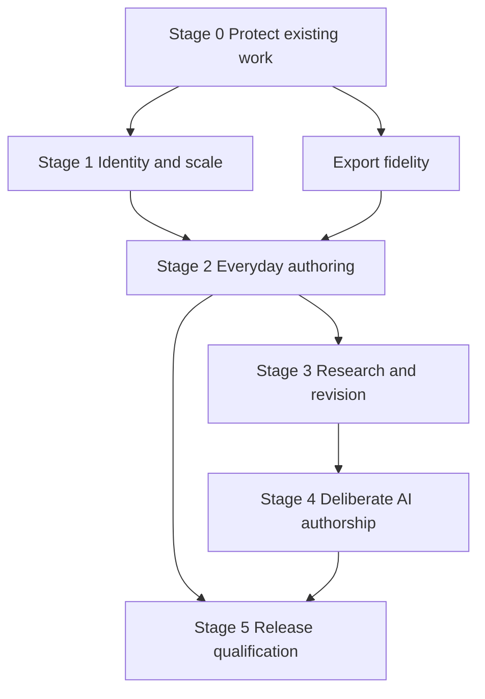

# Manuscript: the plan to make it world class

- **Status:** Proposed, 17 October 2026, and reviewed the same day ([below](#review-2026-10-17)).
- **Baseline:** main at `f494461` ("Manus updates"); the Manuscript package is **0.12.1** [R02].
  Where this plan and the code disagree, the code is current.
- **Standing:** A product and delivery plan. The owner-confirmed decisions in
  [`manuscript.md`](manuscript.md) section 2 stay in force [R03]. Nothing here is an accepted
  ADR, authorises a purchase or a `src/` change, or creates a Work item. The planner was
  unavailable when this was written and when it was reviewed: reconcile the sequence with it,
  and check whether a Work item or Finding already covers MP-01 to MP-03, before
  implementation [R15].

## 1. Recommendation

Make Manuscript a dependable place to develop, write, revise and finish a substantial
manuscript. What should set it apart is working on a passage in context, following the ideas
and evidence connected to it, and changing it without losing its identity or history.

Invest first in **content safety, paragraph identity, writing responsiveness and faithful
export**. Alongside that, build one small demonstration of the paragraph model: link a setup
to its payoff, move either passage, change the setup, and review the payoff through the same
records. It makes the identity work useful to an author early.

Keep the approach already built: an application in a `.nendo` file, a Tiptap custom view
(ADR-0013), readable block records, typed Engine operations and permanent Studio access. A
replacement editor, another storage model or a hosted AI service would add risk without
closing any gap found here [R03] [R11].

"World class" means author outcomes that can be shown:

- An author can trust months of work to it and can see what has been saved.
- A long manuscript stays comfortable through writing, revision and restructuring.
- Planning, research and revision help the author finish.
- Both manual authorship and extensive, authorised AI contribution work.
- Export produces a faithful, editable deliverable.
- Views and methods can be adapted without breaking the writing experience.

The first target is an excellent Windows authoring experience inside Nendo's local,
one-person boundary [R11] [R16]. Public distribution is a separate decision.

## 2. What exists and what needs attention

### 2.1 What is already built

A continuous Tiptap 3 sheet over `mn.block` records, with block IDs kept by the package's own
`BlockIds` extension (split keeps the first ID, join keeps the first, paste takes new ones);
several manuscripts per file; notes and named links; Cuttings; a selection toolbar (W-279),
the formatting bar and a margin grip and plus without a selection (W-282); roles; lists and
tables (W-281); Book and Paper previews; Markdown and editable Word export. Saves are
version-checked `records.batch` writes under a `writeKey`. The package carries its own help
page (ADR-0027). Nendo's own Outline screen reorders blocks; the view's Outline drawer only
navigates [R04] [R05] [R07] [R09].

`tools/Review-Manus.ps1` runs the Node unit tests in `tools/manus/` and the Edge browser lane
`tools/Gate-Manus.mjs` against the shared fixture broker, and is a step of
`Test-Production.ps1`. The export tests read the Word XML, not only the file's existence. The
installed view is checked by the owner; there is no installed-host lane for Manuscript
[R04] [R10] [R19] [R22].

| Area | Now | Consequence for the plan |
| --- | --- | --- |
| Canonical content | Blocks, notes and links are ordinary records; the editor projects them. | Preserve record identity and Studio readability. |
| Writing | A quiet continuous sheet, contextual actions and optional drawers. | Finish everyday actions and behaviour under sustained work. |
| Structure | Part, Chapter and Section headings, several roots, Cuttings; reorder only in Nendo's Outline screen. | Add in-view restructuring and retrieval, not another hierarchy. |
| Revision | Notes with Done, named links with *Needs review* after a merge. | Build an editorial workflow on these. |
| Formatting | Inline marks, alignment, roles, lists, tables; two fixed export layouts. | Add styles and editable output profiles with an explicit fidelity contract. |
| AI | Nendo launches the person's agent (ADR-0030); the view offers *Copy for the agent*. | Add manuscript context, review and run records over that route. |
| Qualification | Unit tests and an Edge fixture lane, part of the full gate. | Add an installed-host lane and real-author evidence. |

The view API already offers things the plan can use without host work: `records.search`
(ADR-0028), `records.tree` and `descendantOf` without the old 10,000 bound (ADR-0019,
amended 2026-10-16), `records.undo`/`records.redo` (ADR-0023, not used by Manuscript yet),
`media.put` (ADR-0031) and `proposals.prepare` [R13] [R14].

### 2.2 Findings that change the delivery order

These are scoped findings, not a test of the installed application.

| Priority | Finding | Evidence | Response |
| --- | --- | --- | --- |
| P0 | Recovery can replay an old full draft over newer content, without asking. | `offerDraft` compares versions only for the blocks the draft touched; when those are unchanged it calls `sheet.restore(draft.doc)` and saves at once. The restored document holds the old text of every other block, and the base signatures come from the fresh read, so an untouched block B changed elsewhere is written back to its old text and a block C added elsewhere is deleted. Reproduced in an isolated Node harness (not in the repository); the code reading agrees [R05] [R07]. | Recover edits against their own base versions; keep unrelated current content. |
| P0 | Deleting a paragraph can count as nothing pending. | `pending()` asks only whether a surviving block changed. A whole-paragraph delete leaves survivors unchanged, so `keepDraft` removes the draft and `changed()` reloads over the unsaved delete when another writer's change arrives [R05]. | One dirty-state model covering inserts, deletes, moves, order, metadata and text. |
| P0 | Draft protection disappears above a size cap or on a storage error, silently. | `keepDraft` removes the draft above 2,000,000 characters of JSON and swallows storage errors [R05]. | Store bounded pending changes; say when recovery cannot be kept. |
| P0 | Markdown export drops Scene break text. | `toMarkdown` writes `* * *` for every Scene break item, so "Three years later" is lost; Word keeps it. A heading with the Scene break role passes it to every paragraph under it, which then all lose their text in Markdown [R08]. | Fix the mapping; add a no-text-loss check. |
| P1 | A save can silently repair structure the person did not touch. | `readManuscript` reads a misplaced row, cell or nested Manuscript block as a paragraph, and `planWrites` writes the new kind and place on the next save, whether or not it was edited [R06]. | Diagnose, preserve and offer an explicit repair. |
| P1 | A large save is several revisions, not one. | `save` sends `chunkWrites(plan)` (200 writes, 240,000 characters each) one after another. A refusal part way leaves the earlier batches committed. The README says a save is "one version-checked `records.batch`" [R04] [R06]. | Make the bound visible, and resumable or refused, per 5.4. |
| P1 | Cut and paste, and undo after a save, make new IDs. | A documented limit [R04]. A pasted paragraph is new; `survivorOf` may hand it the old block's notes and links if its first 40 characters match. Undo after a save re-creates rather than calling `records.undo`, which restores a record under its own ID [R06] [R14]. | An identity-preserving move; saved undo through `records.undo`. |
| P1 | Merge lineage is guessed from text. | `survivorOf` picks the first changed block containing the removed block's first 40 characters; notes and links follow that guess [R06]. | Lineage from transactions and explicit commands. |
| P1 | Identity stops inside a table cell. | A cell may hold several editor paragraphs; `cellInline` joins them into one inline value with line breaks [R07]. A pasted list item's paragraphs are joined the same way, but lists are flat by design (W-281). | Settle the cell grammar before footnotes and richer tables. |
| P1 | Large-manuscript responsiveness is unmeasured. | The view reads every block, note and link in the file on open and on every external change, and rescans the whole document for list markers and word counts. The 20,000-block test in `model.test.mjs` times tree building in Node only [R05] [R07] [R20]. | Measure author actions in the installed host before choosing windowing. |
| P1 | Export scope and preview overflow need targeted checks. | `exportAs` reads `state.root` after an `await`, so a manuscript switch during export may export the other one; preview pages move whole blocks and `.sheet-body` hides overflow. Candidates, not reproduced failures [R05] [R08] [R21]. | Capture the root at export start; test long blocks, tables and switching. |

The recovery harness used the pinned model and the real `pending`, `keepDraft`, `edited`,
`offerDraft` and signature code with fake timers, storage and a plain-text sheet; it reported
three reproductions. It is not an Engine, Tiptap DOM, installed-host or power-loss test. The
Markdown loss was reproduced with the real export module under Node. Neither
`Review-Manus.ps1`, the full gate, the installed app nor Microsoft Word was run for this plan.

### 2.3 Documentation to correct with the first change that touches it

- `extensions/manuscript/README.md`, *Limits*: the 10,000-record bound on Nendo's Outline,
  `descendantOf` and moves was removed by the ADR-0019 amendment of 2026-10-16; only subtree
  aggregates keep it [R13]. The comment above `readBlocks` in `view.mjs` says the same old
  thing.
- The README says a save is one `records.batch`; it is as many as `chunkWrites` makes.
- `manuscript.md` section 3.2 predates delivered export; its "Built so far" is current.

## 3. Product commitments and benchmark

### 3.1 The owner's decisions

These remain requirements [R03].

1. Every paragraph has one canonical place. A reference or preview does not create another placement.
2. Named relationships between passages are supported.
3. Reusable foundations serve a deliberately focused authoring experience.
4. The audience includes authors of novels and other manuscripts.
5. Continuous writing is the default; structural views are optional.
6. Authors have extensive font and layout choices.
7. A general manuscript model supports optional vocabulary presets.
8. AI contribution ranges from none to complete manuscript generation.
9. Normal qualification uses 150,000 words; stress qualification uses 500,000 words.
10. Complete authoring does not depend on an external editor.
11. Markdown and editable .docx are required outputs.

They do not commit the first release to every specialist convention: a technical author does
not imply an equation editor, executable notebooks, legal citation styles or screenplay
production.

### 3.2 What established tools teach

From each product's own documentation, not a hands-on comparison.

| Reference | What to learn | For Manuscript |
| --- | --- | --- |
| Scrivener | Continuous editing across separate pieces, structure, research beside prose, snapshots [W01] | Paragraph storage must carry a complete writing and revision experience. |
| Ulysses | Goals at several scopes, writing history, configurable export [W02] [W03] | Optional progress and output controls that stay understandable. |
| Plottr | Scene cards, timelines, attributes, filters [W04] | Planning views answer questions about structure and sequence. |
| Novelcrafter | A knowledge base, entity tracking, relations, configurable AI context [W05] [W06] | Relationships and an AI panel alone will not set Manuscript apart. |
| Vellum | Separate draft and proof previews [W07] | Say how faithful a preview is; keep expensive layout for deliberate inspection. |

Small pieces assembled into continuous text exist elsewhere. Nendo's opportunity is durable
paragraph identity, explicit relationships, adaptable views and accountable revisions
together. That is a hypothesis to test with authors, not a novelty claim.

### 3.3 Three signature experiences

**Follow a thread.** Pick a character, idea, claim, source or revision issue and read its
passages in manuscript order, with context on demand and the gaps between them shown. Start
with navigation over explicit links; allow editing through the collection only once it uses
the same command path as the sheet.

**See the consequence of a change.** A setup links to its payoff, a claim to its evidence, a
term to its definition. Changing one end makes the link stale and puts it in a located review
queue. It does not declare a contradiction because text changed, and does not pretend explicit
links cover every dependency.

**Complete an editorial pass.** Name an objective, gather located issues, make or request
changes, compare, resolve and export. Tell a moved paragraph from a rewritten one; keep
unrelated edits made meanwhile. This works without AI.

A small version of the first two belongs in the early work. It needs no graph editor, large
relationship taxonomy or workflow engine.

## 4. The experience

### 4.1 Keep the Quiet sheet

Keep design A, the Quiet sheet, and Nendo's Mica shell [R03]. Opening returns the writer to
their last manuscript, passage and appearance; a new manuscript opens on a blank page.

Supporting activities are optional views and drawers, not five toolbars:

- **Write:** prose, selection tools, keys, a modest status.
- **Plan:** outline, section summaries, order, optional cards and progress.
- **Research:** sources, subjects and supporting material beside the text.
- **Revise:** located issues, comparisons, threads, Cuttings, named passes.
- **Prepare:** output profile, preflight, preview, export.

### 4.2 Finish ordinary writing before specialist controls

- Find and replace across the whole manuscript, with scope that says whether Cuttings and
  supporting material are included. The editor holds the whole manuscript, so this is in the
  view; `records.search` can serve supporting records.
- Go to a known passage; insert and edit hyperlinks (the README lists inline links as not
  editable yet).
- Insert a picture in the view with `media.put`, and edit alt text and captions. Today a
  picture block can only be written elsewhere.
- Keyboard structure commands and accessible menus.
- Finish Cuttings: browse, inspect, find the original context, restore to a chosen place with
  identity kept. Edit a note; acknowledge or repair a link that needs review.

The sheet already sets `spellcheck`, so spelling is WebView2's for the languages Windows has.
Test Danish characters, smart punctuation, input-method composition, dictation where present
and mixed-direction text, and state which languages and assistive technologies were exercised.

### 4.3 Three kinds of appearance

**Writing appearance** is personal and per device (it is today, in `localStorage`): typeface,
size, line height, measure, contrast, theme, optional typewriter or focus mode. It never
changes output.

**Document styles** travel with the manuscript: named body, heading, quotation, verse, caption
and other styles, with explicit overrides. Changing a style keeps paragraph IDs and roles.

**Output profiles** set page size, margins, headers, footers, numbering, breaks and the mapping
of roles and styles into Word. The Book and Paper layouts become editable presets; add a
neutral manuscript/report profile.

Offer a good default set of fonts by name. A view cannot list installed fonts: the frame's
permission policy does not grant `local-fonts` [R14], so enumeration would be a host change.
Do not promise font embedding or identical line breaks across machines; warn about
substitution in preflight.

### 4.4 Methods as vocabulary and views

Start with four presets over the same block model: General prose, Fiction,
Argument/research and Technical prose. Fiction adds scene purpose, viewpoint, story time,
characters, locations, promises and reveals; Argument/research adds claims, concepts,
sources, evidence and objections; Technical prose adds terms, components and procedures.

Keep **reading order** apart from **event time**, so a flashback need not sit at its
chronological place. Progress counts drafting, research and revision: a pass that removes
2,000 words can be progress. Goals are optional; no composite "quality score".

## 5. Architecture

### 5.1 Extend the application in the file

Keep `mn.block` as the one composition hierarchy and the current roots. Keep `mn.note`, and
`mn.link` as block-to-block, extending fields compatibly. Passage–source and passage–subject
relations get their own typed records; `mn.link` does not become polymorphic. No second
authoritative document store [R03] [R09].

Add records only when a delivered workflow uses them: likely Subjects, Sources, Revision
passes, proposed changes, Styles, Output profiles and Generation runs. A source locator and
an annotation anchor are different things. Schema additions reach a file as a definition
proposal the person accepts, and `tools/manus/definition.mjs` gains them for new builds.

Editor JSON, search indexes, statistics and summaries are derived and rebuildable; they never
become competing prose. Everything goes through typed services; nothing writes SQLite [R11].

### 5.2 A deterministic lifecycle

| Operation | Identity and review |
| --- | --- |
| Edit or restyle | Keep the block ID; the record version advances; origin and links stay. |
| Move | Keep IDs, notes and links; change parent and order explicitly. |
| Copy | New IDs throughout the copied subtree; relations copied only by explicit choice. |
| Split | The leading part keeps the ID (as now); the rest gets new IDs; record the split. Rebase exact anchors; flag ambiguity. |
| Merge | The first keeps its ID (as now); record the consumed IDs. Retarget anchors from the transaction; make uncertain ones reviewable. |
| Keep as cutting | Move the block under Cuttings (as now). |
| Delete | Apply the declared attachment policy; respect reference rules and compensation. Today notes go and links go with the block. |
| Undo after a save | `records.undo` for this frame's batches, restoring IDs; refuse when another writer changed the record. |
| Restore after reopening | Retained History or a Backup. No cross-session Ctrl+Z. |

Do not infer lineage from matching text. The `BlockIds` extension already maps IDs through
transactions; extend that, and let explicit commands say what moved. Tiptap's UniqueID
extension [W08] is not needed and would not define Nendo identity [R06] [R07].

An orphaned anchor cannot keep a required reference to a deleted block: keep former ID and
quote as provenance, or remove the attached record in the same revision, by declared policy.

### 5.3 One dirty-state path

Keep one explicit set of pending semantic edits, structural ones included, and use it for
autosave, recovery, external changes, agent results, structural views and undo.

Persist a recoverable draft as **pending changes, each with its base version and the base
values and structure needed for a three-way comparison**, never a whole-document snapshot.
Versions alone cannot compare; the view must keep the base content itself, since it cannot
read arbitrary history. The custom-view contract puts drafts in the view's origin storage,
apart from records [R14]; a host draft service would be a separate decision.

Recovery compares local, base and current for the affected blocks, keeps content added or
moved elsewhere and changes to untouched blocks, and shows the passages that need a choice.
"Put mine back" never overwrites an unrelated section.

`send` already retries an unanswered batch once under the same `writeKey`, and block creates
carry their own IDs, so a repeated create collides rather than duplicates. What is missing is
persistence: store the key and payload before sending, so a frame stopped mid-save finishes the
same write on restart instead of minting a new one [R14].

States the status line must keep apart (it may compress them visually):

- **Editing:** changes not yet acknowledged.
- **Recoverable on this device:** the pending journal holds them.
- **Saving:** a write is in flight.
- **Saved:** the host acknowledged it.
- **Needs attention:** a save, recovery or reconciliation could not complete.

### 5.4 Transaction and undo bounds

A batch is atomic up to 200 writes and 250,000 characters. `records.move` is not a batch
member; parent and order updates are [R14]. Today a save above that is split into several
batches (2.2). For a larger edit choose one, and say which:

1. A bounded edit that fits one batch.
2. A staged draft promoted through version-checked operations. Never replace the active file
   with a proposal clone. Staging does not make a promotion above 200 writes atomic.
3. A resumable multi-batch job with progress, committed boundaries and a recovery plan.

Refuse a single oversized edit before anything is written, keep the pending work and name the
limit. Never split a paragraph to fit transport bounds.

`records.undo` covers this frame's batches only; a remounted frame starts with none, and a
move or command has no revision to undo [R14] [R25]. Richer revision workflows use History,
compensation and Backup as they are, or wait for an accepted host change (5.9).

### 5.5 Settle the nested grammar first

A table owns rows, a row owns cells, and a cell should own identified paragraph blocks rather
than one joined inline value. Footnotes need the same: a container owning paragraphs. Lists
stay flat, a list being a property of its paragraphs (W-281, as Word keeps them); a
continuation paragraph inside an item is a flat paragraph too and needs no container.

Migrating existing cells keeps the cell ID, gives new IDs to text that never had its own, and
keeps an explicit mapping. A link to a cell does not silently become a link to an arbitrary
paragraph. The migration preserves text, formatting, order and references, resumes when it
spans batches, and clears the old text only once its replacement is committed. Test existing
files and both content profiles.

The Engine enforces hierarchy and reference rules; the manuscript grammar is the app's. Editing
must not silently repair unrelated malformed or future content (2.2) [R06] [R07].

### 5.6 Optimise the integration before replacing the editor

The cost candidates are whole-file reads on open and on every `changes` nudge, whole-document
list-marker and ID scans per transaction, word-count recomputation, overlay geometry and
whole-document draft serialisation. None shows that Tiptap cannot carry the manuscript.

In order:

1. Track dirty blocks and keep IDs and positions through transactions.
2. Cache per-block counts; update affected totals.
3. Recompute only the affected list runs and visible adornments.
4. Read only the active manuscript (`records.tree` from its root) and its notes and links.
5. Refresh changed content without replacing a focused editor or pending work.
6. Measure in the installed host with the agreed workloads.
7. Window only if the measurements still require it.

Keep one continuous editor; never one editor per paragraph. If windowing comes, cross-window
selection, keyboard movement, composition, search, paste and undo stay requirements [W09].

A view learns only that the file changed, not which records (the `changes` event is a nudge).
MCP clients already get record-level notifications (W-171); giving views the same is a host
change (5.9) [R12] [R14].

### 5.7 Long-project durability

Every record write adds an operation row. A file refuses writes from 99,000 operation rows
until the person folds history (ADR-0021, which backs up first), and holds at most about
98,000 records [R13] [R17] [R27]. For a writing tool this, not bytes, is the binding limit.

Measure rows per writing hour, per major restructure and per generated chapter. Show a gentle
indication of headroom and the route to History's fold before a bulk job would run out. The
view API has no read of row use or file health today, so the indication needs a host change
(5.9). Do not coalesce or erase operations in the app.

A **Milestone** names a manuscript state (the design's term; *Checkpoint* is the fold's).
A revision a Milestone names can be folded away; a state that must survive a fold needs a
Backup (ADR-0010), and the display says whether one exists. A view cannot make or list
Backups, so that part is a host change too. A Markdown or Word export is not a backup.

Before long-project qualification, restore a Backup into a disposable copy, including one
taken before a fold, and check text, order, IDs, links, notes, Cuttings, media and other
records. A backup that exists or opens has not yet been shown to restore.

### 5.8 Agent contribution is not authority

Access is file-wide and cumulative across five levels, Off to Unattended [R12].

| Level | What a manuscript workflow may do |
| --- | --- |
| Inspect | Read and critique in the conversation; cannot save notes, run records or proposals. |
| Edit data | Write data under a lease, notes and draft records included; no change sets. |
| Shape app | Also prepare and validate change sets; the person accepts. |
| Unattended | Also accept its own session's validated proposals. |

"Critique", "Suggest changes" and "Draft these sections" are modes of contribution, not
confinement. Nothing enforces draft-only, selected-paragraph-only or proposal-only writing;
making that a guarantee needs Engine and MCP enforcement and an ADR (5.9).

The agent is the person's own, launched over ACP on the Agent page (ADR-0030) and working
through MCP. The view cannot start or prompt it. Today's handoff is the clipboard (*Copy for
the agent*); a richer clipboard handoff (IDs, versions, scope, context manifest) is app-only,
and a direct route from a view to the Agent page is a host change [R18].

A generation run records the brief, target IDs and base versions, source and context
versions, completed `writeKey`s, created records, open issues and origin. Keep context
manifests and summaries rather than resending the manuscript; a summary is stale when its
source changes. Prefer a separate draft root until applying to accepted prose is authorised
(Q-02). A clearly authorised larger run proceeds section by section, cancellable and
resumable, checking target conflicts and stale context.

No background agent or embedded model client (ADR-0014, vision). A monetary cap is promised
only where the agent exposes enforceable accounting; a token estimate is not a cap.
Provenance records known operations, not a guess at who wrote prose.

### 5.9 What needs a host change or an ADR

Each of these is outside the app-only lane. Write the ADR or amendment first (the owner
pre-accepts ADR changes, but the ADR still comes first), and run the full gate and installer
for it. Do not let an MP item assume one silently.

| Need | Why the app cannot do it | Used by |
| --- | --- | --- |
| A view read of operation-row use and headroom | The view API has no health or history read | 5.7, MP-12, MP-19 |
| Record-level change events for views | `changes` is a nudge only | MP-07 (only if the measurements need it) |
| Making and listing Backups, reading History from a view | Not in the view API | MP-12, MP-15 |
| A route from a view to the Agent page with a prompt | Not in the view API; ADR-0030 starts sessions from the Agent page | MP-16 (optional) |
| Scope-confined agent writes (draft-only, paragraph-only) | Access is file-wide; not enforced | MP-17, MP-18 (only if required) |
| Listing installed fonts | The frame's permission policy lacks `local-fonts` | MP-11 (optional) |
| Changing history retention or coalescing writes | Engine audit semantics (ADR-0006, ADR-0021); Q-06 | 5.7 |

## 6. Delivery

Short, reviewable changes, each with its guard and documentation. These are sequencing
recommendations, not dates; estimate the rest from the first tranche's actual effort.

The phases are called **stages** here, so as not to collide with the product's Milestones.

### 6.1 Stages

| Stage | Outcome | Packages | Exit |
| --- | --- | --- | --- |
| 0 Protect existing work | Pending edits, recovery and export cannot silently lose content. | MP-01 to MP-04 | Each reproduced defect has a guard in `Review-Manus.ps1` shown failing against the old code. |
| 1 Prove the paragraph | Identity holds across supported edits; scale is measured; one linked revision works. | MP-05 to MP-08 | Identity tests pass; installed-host baseline recorded; the setup/payoff demonstration works. |
| 2 Everyday authoring | Structure, format, revise and export an ordinary manuscript without Studio. | MP-09 to MP-12 | Three fixtures complete the manual authoring-to-export journey. |
| 3 Whole-work revision | Sources, subjects, threads and passes help with difficult revision. | MP-13 to MP-15 | A real cross-manuscript revision finishes with traceable decisions and no unrelated change. |
| 4 Deliberate AI authorship | Critique, proposed revision and full drafts use the same foundations. | MP-16 to MP-18 | Interrupted generation resumes without duplicates or overwrite; stale context is detected; manual mode stays complete. |
| 5 Qualify a release | Evidence supports the claims made. | MP-19; MP-20 if chosen | Agreed journeys, installed-host and output checks pass; limits are written down. |



The Scene break fix is in Stage 0. Wider output work can run beside the identity and
performance work where the files do not overlap (`export.mjs` and `preview.mjs` against
`view.mjs`, `editor.mjs` and `model.mjs`). The owner uses each stage as it lands; Stage 5 is
not the first time anyone writes with the changes.

### 6.2 Work packages

MP numbers are this plan's own, not Work records. Unless marked **host**, a package is
app-only: `extensions/manuscript/`, `tools/manus/`, `Gate-Manus.mjs`, `Review-Manus.ps1`,
`Build-Manus.mjs`. It needs `Review-Manus.ps1`, each new guard falsified, and
`Test-Repository.ps1`, and reaches a file as a package proposal (`Put-NendoPackage.mjs`).
Changing the shared fixture broker (`Graph-FixtureBroker.html`, `Graph-FixtureServer.mjs`)
is a shared-tool change and needs the full gate; the broker already has `drop`, `hold`,
`fail`, `remount`, `pushChanges`, `writeKey` replay and `records.undo`, which Stage 0 needs
[R30].

**MP-01 — One truthful pending state. P0; Stage 0.**
Change detection covers deleted IDs, membership, parent, sibling order, text, title and
metadata, and the same state drives draft retention, external changes and save decisions
(`view.mjs`, `editor.mjs`, `model.mjs`).
*Accept:* deleting or moving an unchanged paragraph stays pending; a `changes` nudge does not
reload over it; a save clears only what was acknowledged; typing during a save stays pending.
Each guard is shown failing with the old `pending()` restored.

**MP-02 — Recovery against base versions. P0; Stage 0; after MP-01.**
A versioned recovery format (`manuscript.draft.v2`) of pending edits with base versions and
base values, plus unsent batches with their `writeKey`. A v1 draft is offered for review, never
auto-replayed. Conflicts are resolved passage by passage.
*Accept:* with a local edit to A, a newer B and an added C, recovery writes only A; B and C
stay. External moves, deletes and same-target edits are exercised. A draft that cannot be
stored is shown. A remount between send and answer (`drop`, `remount`) finishes the same batch
once.

**MP-03 — No silent loss in export. P0; Stage 0; independent.**
Fix Scene break in `toMarkdown` and state the export invariant: author text is left out only
when excluded from publication, or when a declared policy chooses another representation.
*Accept:* a custom Scene break keeps its text in Markdown, including under a heading with that
role; text, headings and order agree with `exportPlan`; Cuttings and notes stay out; anything
unsupported gets a located warning or a refusal. A unit test in `export.test.mjs` compares the
plan's text with each format's output.

**MP-04 — Diagnose, don't repair. P1; Stage 0.**
Detect malformed or unknown structure on read, keep it, and stop an unrelated save from
rewriting it (2.2). Document the supported content profile.
*Accept:* a misplaced row or cell, or an unknown kind, written through the broker as another
client would, is shown and left byte-for-byte unchanged by an unrelated edit; a proposed repair
is visible and undoable.

**MP-05 — Identity-preserving editing and undo. P1; Stage 1; after MP-01, MP-02.**
Lineage from transactions and commands, not `survivorOf`. An explicit Move command and
recognised same-manuscript cut and paste. Saved undo through `records.undo`, joined with the
editor's own undo, within the frame and version limits.
*Accept:* repeated identical paragraphs cannot misdirect notes; split, merge, move, delete,
undo and redo have specified IDs and attachments; a copy gets new IDs; undo after another
writer's change is refused, not forced. No claim of universal or persistent Ctrl+Z.

**MP-06 — Paragraphs in cells and footnotes. P1; Stages 1–2; after MP-05.**
The content grammar and inline profile written down; identified paragraphs in cells; the
container and anchor model for footnotes. MP-09 and MP-11 own footnote authoring and export.
*Accept:* a paragraph in a cell or footnote can be addressed, linked, edited, restored and
exported on its own. An existing file migrates through typed batches with the text kept and
an explicit ID mapping, and survives interruption.

**MP-07 — Measure and improve scale. P1; Stage 1; after Stage 0.**
Deterministic fixture generators in `tools/manus/`; the optimisations in 5.6. Build an
installed-host measurement lane (WebView2 over CDP against a task-owned copy). If that lane
needs shared host tooling, that part is a host change.
*Accept:* published workload counts and p50/p95 latencies; the typing targets in 7.2 met;
budgets for opening, search, stress navigation and memory recorded from the measured baseline
for Stage 5; a second manuscript in the file adds no whole-file work to the first. A decision
on windowing from the numbers.

**MP-08 — First linked revision journey. P1; Stage 1; after MP-05.**
Link two passages, navigate with context, move one, revise one, review the consequence and
acknowledge the link.
*Accept:* the same IDs and links survive; a link whose end changed since review is marked;
acknowledging records the reviewed versions. Done without Studio or an agent.

**MP-09 — Complete the writing surface. P1; Stage 2.**
The list in 4.2, and footnote insertion, editing and navigation over MP-06.
*Accept:* the ordinary journey works inside Manuscript; find and replace reaches content
outside the viewport; footnotes can be inserted, edited, reached from their anchors and left
by keyboard; menus, saving and analysis never move the caret; the tested input methods and
assistive technologies complete it.

**MP-10 — Structural editing and Cuttings. P1; Stage 2; after MP-05.**
Reorder in the view's Outline by pointer and keyboard; section summaries and status; a full
Cuttings drawer; cards only where they help.
*Accept:* moving five sections gives the same order in the sheet, the outline, threads and
export; a cutting restores with its ID; structural changes can be compared and undone within
`records.undo`'s limits.

**MP-11 — Styles and output profiles. P1; Stage 2; after MP-03, MP-06.**
The three appearance layers, named styles, explicit overrides, editable profiles.
*Accept:* changing writing appearance never changes export; a style change keeps IDs;
substitution and unsupported formatting are reported; a block taller than a page stays visible
in preview; Word gets real styles, headings, lists, tables and native footnotes, Markdown a
declared footnote extension or fallback. Endnotes are a later increment.

**MP-12 — Everyday revision and Milestones. P1; Stage 2.**
Note editing, issue status, named passes, comparison against a Milestone's recorded content.
No branching system.
*Accept:* a writer finishes a named pass, sees open issues, inspects what changed and restores
supported changes without erasing unrelated edits. Telling a revision label from a Milestone
backed by a Backup needs the **host** reads in 5.9; until then the UI says only what the app
itself knows.

**MP-13 — Sources and subjects. P2; Stage 3; after MP-06, MP-08.**
Source and subject records with aliases, descriptions and locators; typed passage–source and
passage–subject records; fiction and nonfiction presets. A simple source and locator first; a
bibliographic engine is separate.
*Accept:* every linked passage for a source or subject can be found; its context shows beside
the sheet; references survive reordering; an unavailable external source is not shown as kept
evidence.

**MP-14 — Threads and consequences. P2; Stage 3; after MP-08, MP-13.**
Saved collections, filtering and dependency review; optional chronology and reader-knowledge
questions for fiction; definition and evidence checks for nonfiction.
*Accept:* edit twelve passages through a thread, move three, reopen the thread and see the same
records; explicit dependencies are reported apart from AI-suggested ones; no paragraph gains a
second owner.

**MP-15 — Substantial revision passes. P2; Stage 3; after MP-12, MP-14.**
Issues and proposed changes under a purpose; comparison with move, split and merge lineage;
partial acceptance against base versions; rejected alternatives kept outside the composition.
*Accept:* the manual demonstration in 7.4 completes; partial acceptance keeps later unrelated
edits; a large reversal that cannot be atomic is described as a checked job.

**MP-16 — Manuscript skill and agent handoff. P2; Stage 4; after Stage 1 and MP-13.**
A file-carried skill (ADR-0024) with instructions, examples and the content matrix; a
structured clipboard handoff with manuscript and target IDs, base versions, scope, context
manifest and desired result. A direct route to the Agent page is **host** (5.9) and optional.
*Accept:* an agent new to the project follows the schema and lifecycle; at Inspect it
critiques without claiming to save; stored results use a permitted write path; large context
is read narrowly and reused.

**MP-17 — Reviewable AI revision. P2; Stage 4; after MP-15, MP-16.**
Critique and proposed changes under the existing access levels; a review of changed passages,
reasons and sources.
*Accept:* a target edited meanwhile shows as a conflict; a changed source invalidates the
reviewed basis; a contribution mode never widens access; accepted prose changes only under the
workflow as described.

**MP-18 — Resumable full-draft generation. P2; Stage 4; after MP-17.**
A run ledger and section-by-section work through the open agent, into a separate draft root by
default, recorded apart from the chat transcript.
*Accept:* interrupt after several batches, change a source and a target paragraph, resume
deliberately: completed sections are kept once, staleness and conflicts are reported,
cancellation keeps committed work, and cost controls say whether they are estimates, counts or
enforceable limits. The draft is checked against its brief (coverage, missing or repeated
sections, style constraints, located continuity or evidence issues; unresolved citations stay
visible). That makes a reviewable draft, not a promise of publishable prose.

**MP-19 — Qualification and release readiness. Cross-cutting; Stage 5.**
The owner writes with each stage. External authors only after the owner decides on
distribution (7.5).
*Accept:* the agreed author tasks succeed; content and migration checks pass; the recorded
budgets are met; the backup-restore drill passes, including a pre-fold backup; limits are
written down. Nendo's accepted prototype limits are not relabelled as passes.

**MP-20 — Bounded import. Conditional; an owner decision.**
A one-time Markdown or text import, before inviting writers with existing projects; a declared
DOCX subset only when needed. Import was not settled in the requirements.
*Accept, if adopted:* a conversion preview; the source kept; new IDs; unsupported content
reported with location and count; no claim of lossless Word round-trip.

## 7. Qualification

### 7.1 Reference workloads

Deterministic fixtures on task-owned copies under `artifacts/`; never a `workspace/` file as a
failure fixture [R15].

- **Small regression fixture:** the content matrix with easily read IDs and expected exports
  (today's `definition.mjs` fixture is the start).
- **Normal:** 150,000 words, varied chapters, notes, links, lists, tables and pictures.
- **Stress:** 500,000 words, many short paragraphs, one long section, long paragraphs, nested
  content, dense notes and links, some history.
- **Several manuscripts:** one active among others, so scope leaks show.
- **Boundaries:** near record, history, request and media limits; missing media; malformed
  structure; an old schema (no Role, no table kinds); no search index; non-ASCII text.

Count words, blocks, cell paragraphs, notes, links, media bytes and history rows separately.
Every created record costs an operation row, and a file holds at most about 98,000 records
and refuses writes from 99,000 rows (5.7). At 20 to 25 words a paragraph the stress
manuscript is 20,000 to 25,000 blocks before notes, links and edits, so its history must be
budgeted against that ceiling, and the ceiling itself is a stress case.

### 7.2 Performance and reliability gates

Targets, not current claims. The input and navigation targets are the design's [R03].

| Measure | Normal | Stress | Evidence |
| --- | --- | --- | --- |
| Input to paint, p95 | ≤ 50 ms | ≤ 100 ms | Installed host; typing, formatting and composition. |
| Go to a known paragraph, p95 | ≤ 250 ms | Set from the Stage 1 baseline | Targets far from the view. |
| Opening, cold and warm | Report distributions | Report distributions | Machine, host, package and WebView2 versions, cache state. |
| Find and replace | Whole manuscript, right scope | Same | Latency and progress; all matches covered. |
| Large paste and restructure | IDs, order and attachments right | Same, with the bounded-job rule | Batch limits, cancellation, partial failure. |
| Forced process kill | Every acknowledged edit kept | Same | Kill before and after commit and acknowledgement, on copies. |
| Recovery after a frame stops | No unrelated overwrite | Same, with storage quota | Journal acknowledgement apart from save. |
| Memory over a long session | No unbounded growth | Same | Peak and trend; a budget from the baseline. |
| History use | Rows per workload | Same | Warnings and the fold route use real host values. |
| Export | Supported content kept | Complete, off-screen content too | Structural checks, a real download, Word. |

Stage 1 records budgets for opening, search, stress navigation and memory; Stage 5 meets them.
A slow measurement reported is not a pass: change the code or narrow the claim.

Also measure: selection across sections, split and merge of repeated prose, cut and move, undo
after autosave, a large formatted paste, navigation with previews open, and an agent's change
arriving while local edits are pending.

A forced kill is not a power-loss guarantee; physical power loss is not qualified [R24].

### 7.3 Content and output contract

| Content | First qualified behaviour | Later, or a stated limit |
| --- | --- | --- |
| Paragraphs, headings, roles | Stable IDs, readable storage, consistent hierarchy and export | More heading vocabularies are presets, not another engine. |
| Inline emphasis and links | A declared round-trip subset; links editable in the view | No arbitrary HTML, CSS or imported marks. |
| Lists and tables | Every paragraph identified; native Word structures; declared Markdown mapping | Merged cells and complex layout are their own increment. |
| Pictures | Insertion with `media.put`, embedded or linked, alt and caption editing, missing-media preflight | A web address does not imply offline availability. |
| Footnotes | Stage 2: identified content, insert, edit, navigate, native Word (MP-06, 09, 11) | Declared Markdown extension or fallback; endnotes later. |
| Citations | A source reference and locator with provenance | CSL and bibliographic styles are a later decision. |
| Equations, code, specialist forms | Preserved or refused explicitly | Maths typesetting, screenplay and indexing are separate capabilities. |
| Word profiles | Editable semantic document, styles, supported page controls | No exact cross-machine pagination or desktop-publishing parity. |
| Markdown | A declared subset and its losses | No fonts or page geometry. |

Capture the root and a coherent read at export start. Use the host's change-bound cursors:
retry or report a stale read rather than mixing pages. Record the change sequence exported and
the counts included.

A layout preview is approximate; a valid ZIP, a browser screenshot and a download answer
different questions. Open representative `.docx` files in Microsoft Word during qualification;
authors should not need Word to finish.

### 7.4 Two demonstrations

**Manual: revise a linked manuscript.** Open the normal fixture and return to the last
passage; write and format across paragraph and section boundaries; change a setup or claim;
review the linked payoff; edit it through a thread with context; move a section, undo one
supported change and restore a cutting; finish the pass; export Markdown and Word.
*Expected:* correct prose, stable IDs, notes and links kept, consistent order, no AI calls,
faithful outputs.

**AI: interrupt and resume a substantial draft.** Choose an outline, sources and target scope;
start a draft through the person's agent; interrupt after some batches; edit one target
paragraph and change one source; resume deliberately; inspect conflicts and staleness and
accept the safe work.
*Expected:* no duplicate sections, no overwrite of the human edit, staleness shown, provenance
kept, honest progress and cost. Checked against the brief. A full-draft qualification
eventually runs at the agreed scale, not one paragraph.

### 7.5 People

Thomas's own writing at every stage is the first evidence, recorded as owner-reported. Nendo
1.0 is for one person's use [R16]; observing other authors follows an owner decision on
distribution. If that comes, observe a few authors on the same tasks (start writing,
restructure, a linked revision, export) on synthetic material or a consented copy.
Correctness has no tolerance: no observed task may lose data, misplace links or hide a save or
recovery failure. Time targets are set after the first observations, and correctness is never
tuned down to reach them.

## 8. The first tranche

In this order, each fix with its guard and documentation:

1. **MP-03, export semantics.** Smallest and independent: Scene break text, a
   content-preservation test across roles, lists and table cells, and the root captured at
   export start.
2. **MP-01, structural dirty state.** Reproduce the delete-only case in `Gate-Manus.mjs`;
   cover reorder and reparenting; fix; falsify.
3. **MP-02, safe recovery.** The untouched-B and added-C cases, base-version reconciliation,
   v1 draft handling, persisted `writeKey`s and visible journal failure, in the browser lane
   (the isolated harness is not enough).
4. **MP-05, move and undo.** A bounded selection in one manuscript with its notes and links,
   using batch parent/order updates and `records.undo`; any case left out is a stated limit.
5. **MP-07 and MP-08, measure and demonstrate.** The installed baseline at normal and stress
   size, and the setup/payoff journey. Their evidence picks the next optimisation and the next
   author-facing step.

Each delivered fix is recorded as a Finding with its falsification text once the planner is
back (AGENTS.md, *When something is reported broken*).

### Handoff for the first change

A task specification, not approval to implement.

```json
{
  "plan_reference": "MP-01",
  "title": "Make pending manuscript state include structural edits",
  "reviewed_base": "f494461",
  "standing": "Proposed; reconcile with the planner's Work items and their Decision standing first",
  "goal": "Deleting, moving or reparenting unchanged content stays pending until the write that carries it is acknowledged",
  "read_first": [
    "AGENTS.md",
    "docs/dogfooding.md",
    "docs/design/manuscript.md",
    "docs/contracts/custom-views.md (Writes, Undo and redo, Drafts)",
    "extensions/manuscript/view.mjs (pending, keepDraft, offerDraft, save, changed)",
    "extensions/manuscript/editor.mjs (read, saved, BlockIds)",
    "extensions/manuscript/model.mjs (planWrites)",
    "tools/Gate-Manus.mjs",
    "tools/Graph-FixtureBroker.html (pushChanges, drop, remount; read only)"
  ],
  "change_scope": [
    "extensions/manuscript/",
    "tools/manus/",
    "tools/Gate-Manus.mjs",
    "tools/Review-Manus.ps1"
  ],
  "reproduce": [
    "Delete a whole paragraph so no surviving block's signature changes",
    "Let the draft timer run before the save",
    "Assert pending() is true and the draft is kept",
    "Push a changes event from another writer before the save",
    "Assert the local delete is not reloaded away and is saved"
  ],
  "acceptance": [
    "Text, metadata, membership, parent and order changes share one dirty-state path",
    "A save clears only the acknowledged edits",
    "Typing during a save stays pending",
    "Each new guard is shown failing with the old pending() restored, and the failure text quoted",
    "No workspace file is used as a failure fixture",
    "Package version, README and help updated with the behaviour"
  ],
  "validation": [
    "pwsh ./tools/Review-Manus.ps1",
    "pwsh ./tools/Test-Repository.ps1",
    "If the fixture broker, a contract or src/ must change, the full gate and installer rules in AGENTS.md apply instead"
  ],
  "handoff": [
    "The live Work reference once the planner is back",
    "Changed paths and exact commands with outcomes",
    "Automated, agent-observed, owner-reported and not-run evidence kept apart",
    "The package proposal's exact title, not described as applied",
    "Remaining recovery risks for MP-02"
  ]
}
```

## 9. Decisions and scope

| Decision | Recommended default | Standing |
| --- | --- | --- |
| Architecture path | Extend the app and view already built. | Q-04, answered 2026-10-16. Host changes only for the gaps in 5.9. |
| Inline content | The declared inline Markdown subset plus paragraph fields and styles. | Q-05, taken as recommended and still open to the owner; richer typography decided by fidelity examples. |
| Layout boundary | Rich document layout with editable profiles. | Proposed answer to Q-01; keep Paper's two columns, no free desktop publishing. |
| AI and accepted text | A separate draft by default; explicit broader delegation. | Proposed answer to Q-02; not technical confinement. |
| Dependencies | Open source and local first; reuse the bundled components. | Continues Q-03's recommendation; a paid component needs a benefit, a licence check and purchase authority. |
| History budget | Measure, show headroom, guide to the fold and Backup. | Q-06, answered from measurements; no hidden coalescing or automatic deletion. |
| Import | A bounded one-time import. | MP-20; an owner decision, not needed for the owner's own use. |
| Wider release | Qualify the authoring first, then decide distribution and support. | Separate from app quality. |

Not by default: real-time collaboration, cloud sync, cross-platform parity, a mobile app, a new
database, background agents, an embedded model client or a desktop-publishing canvas. Each
changes Nendo's boundaries [R11].

## 10. Delivery discipline

The planner is the primary record. Resolve Work, Finding, Check and Decision records and their
standing when it is reachable; do not assume this plan supersedes work already Doing, and do
not build a replacement planner from it [R15] [R23].

- App-only changes (6.2) need `Review-Manus.ps1` with each new guard falsified, plus
  `Test-Repository.ps1`; that is enough to commit. The package reaches a file as a proposal
  the person accepts; a prepared proposal is not an applied one.
- A change under `src/` or `tests/`, to a contract, an ADR or a shared tool (the fixture
  broker included) needs `Test-Production.ps1` and the installer rebuilt.
- `Review-Manus.ps1` is a step of `Test-Production.ps1`, so the periodic full gate across a
  run of app-only changes covers it.
- Update the package README, help and this plan with the behaviour they describe.
- Keep reproducible checks in the test suite, not run outputs in `artifacts/`.

Keep evidence kinds apart: code reading and inferred risk; isolated logic checks; the fixture
browser lane; the installed host; the owner's and other authors' use; Word inspection. This
plan has the first two.

## 11. Sources

Paths are relative to this file. Read the current files during implementation.

- **R02** [Package manifest][R02] · **R03** [Manuscript design][R03], sections 2, 6, 10, 11 and 16
- **R04** [Package README][R04] · **R05** [`view.mjs`][R05]: `keepDraft`, `offerDraft`, `readAll`, `pending`, `save`, `send`, `changed`, `exportAs`
- **R06** [`model.mjs`][R06]: `readManuscript`, `assignOrders`, `survivorOf`, `planWrites`, `chunkWrites`
- **R07** [`editor.mjs`][R07]: `BlockIds`, `flattenLists`, `cellInline`, `read`
- **R08** [`export.mjs`][R08]: `exportPlan`, `toMarkdown`, `toDocx` · **R09** [`definition.mjs`][R09]
- **R10** [`Review-Manus.ps1`][R10] · **R22** [`Gate-Manus.mjs`][R22] · **R30** [Fixture broker][R30]
- **R11** [Vision][R11] · **R16** [README][R16] · **R17** [Architecture][R17] · **R24** [Roadmap][R24]
- **R12** [MCP interface][R12]: access levels, record notifications, acceptance
- **R13** [ADR-0019][R13], amendment of 2026-10-16 · **R25** [ADR-0023][R25] · **R27** [ADR-0021][R27]
- **R14** [Custom views contract][R14]: Writes, Undo and redo, frame permissions, limits
- **R15** [AGENTS.md][R15] · **R23** [Dogfooding][R23] · **R18** [ADR-0030][R18]
- **R19** [`export.test.mjs`][R19] · **R20** [`model.test.mjs`][R20] · **R21** [`view.css`][R21]
- **W01–W09** Product and editor documentation, read 17 October 2026 by the plan's author;
  not opened again in the review.

[R02]: ../../extensions/manuscript/nendo-package.json
[R03]: manuscript.md
[R04]: ../../extensions/manuscript/README.md
[R05]: ../../extensions/manuscript/view.mjs
[R06]: ../../extensions/manuscript/model.mjs
[R07]: ../../extensions/manuscript/editor.mjs
[R08]: ../../extensions/manuscript/export.mjs
[R09]: ../../tools/manus/definition.mjs
[R10]: ../../tools/Review-Manus.ps1
[R11]: ../vision.md
[R12]: ../contracts/mcp-interface.md
[R13]: ../decisions/0019-hierarchies-in-the-schema.md
[R14]: ../contracts/custom-views.md
[R15]: ../../AGENTS.md
[R16]: ../../README.md
[R17]: ../architecture.md
[R18]: ../decisions/0030-launch-the-persons-own-agent-over-acp.md
[R19]: ../../tools/manus/export.test.mjs
[R20]: ../../tools/manus/model.test.mjs
[R21]: ../../extensions/manuscript/view.css
[R22]: ../../tools/Gate-Manus.mjs
[R23]: ../dogfooding.md
[R24]: ../roadmap.md
[R25]: ../decisions/0023-a-view-undoes-its-own-revisions.md
[R27]: ../decisions/0021-folding-old-history.md
[R30]: ../../tools/Graph-FixtureBroker.html
[W01]: https://www.literatureandlatte.com/scrivener/overview
[W02]: https://help.ulysses.app/goals
[W03]: https://help.ulysses.app/export
[W04]: https://plottr.com/features/
[W05]: https://www.novelcrafter.com/features
[W06]: https://www.novelcrafter.com/help/docs/codex/codex-tracking
[W07]: https://help.vellum.pub/preview/
[W08]: https://tiptap.dev/docs/editor/extensions/functionality/uniqueid
[W09]: https://tiptap.dev/docs/guides/performance

## Review, 2026-10-17

An independent review against the code at `f494461`. The planner was down, so no W- or F-
reference was checked against it.

**Changed**

- Findings (2.2): sharpened the recovery P0 (it restores without asking when the touched
  blocks are unchanged); added the heading-role case to the Scene break loss; added two P1s
  from the code, the silent structural repair on save and the multi-batch save the README calls
  one batch; dropped line numbers that had drifted.
- 2.1 now names what the view API already offers (`records.search`, `records.undo`,
  `media.put`, unbounded `records.tree`), the package's own `BlockIds` extension, and that
  `Review-Manus.ps1` is in the full gate while no installed-host lane exists.
- New 5.9 lists the needs that are host changes or ADRs: row-budget and Backup/History reads,
  record-level view events, a view-to-Agent-page route, agent scope confinement, font listing.
  MP-12, MP-16 and the budget indicator no longer assume them.
- 5.7 and 7.1 state the 99,000-row and about 98,000-record ceilings and what they mean for the
  500,000-word fixture.
- 5.5 and MP-06: lists stay flat (W-281); only cells and footnotes need containers.
- Delivery milestones renamed stages, to keep clear of the product's Milestones. 6.2 states
  the gate per package (the fixture broker is a shared tool); the first tranche starts with
  MP-03; vague acceptance made measurable.
- 7.5: the owner's use first, external pilots after a distribution decision, no percentage
  targets. Sources are relative links; padding cut throughout.

**Open questions for the owner**

1. External pilot authors: in scope at all, given Nendo 1.0 is for one person's use?
2. Is a Backup-backed Milestone (a host change) wanted, or is a retained revision label enough?
3. MP-20 import: wanted before inviting anyone with an existing manuscript?

The file was renamed from `MANUSCRIPT_WORLD_CLASS_PLAN.md` to follow the folder's naming, and
`manuscript.md` section 15 links here (owner, 2026-10-17).
